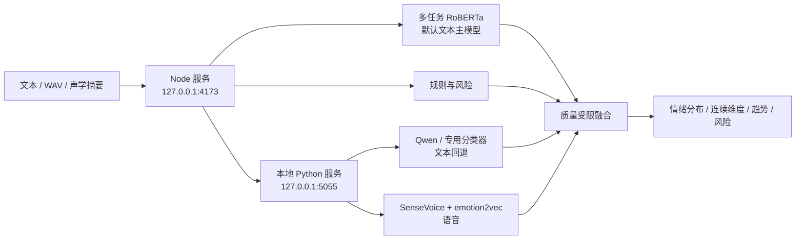

# Emotional Comfort Agent System

情感陪伴机器人项目的多人协作仓库。当前已交付的是**普通话情感识别模块**，它接入本地多任务 RoBERTa、Qwen、SenseVoice 和 emotion2vec，同时保留文本规则、专用分类器和浏览器声学特征作为自动回退。

人格建模、回复策略和方言 TTS 仍由其他模块负责。当前方言接口只提供显式普通话 fallback，不包含方言 ASR 或方言情绪模型。

## 交付入口

| 文档 | 用途 |
| --- | --- |
| [情感识别接口与协作规约](docs/emotion-recognition-spec.md) | 当前 HTTP 端点、字段、枚举和兼容性规则 |
| [多人协作与跨模块集成契约](docs/team-integration-contract.md) | 模块边界、下游消费顺序、数据和分支规范 |
| [情感识别模块交付报告](docs/emotion-recognition-delivery-report.md) | 能力、指标、模型交接、限制和接手方式 |
| [模型权重交接](docs/model-handoff.md) | 文件清单、哈希、目录结构和加载检查 |
| [技术问答稿](docs/group-meeting-technical-qa.md) | 常见技术追问和回答口径 |
| [两周阶段报告](docs/two-week-group-meeting-report.md) | 完整实验、数据和错误分析 |
| [长期需求与规划](docs/emotion-recognition-future-spec.md) | 文本、语音、视觉、方言和个人基线的后续设想 |
| [组会答辩 PPT](outputs/情感识别模块_两周组会汇报_v1.pptx) | 11 页阶段汇报材料 |
| [第三方依赖与数据说明](THIRD_PARTY_NOTICES.md) | 模型、数据许可证和使用注意 |

## 当前模块结构



主要目录：

| 路径 | 内容 |
| --- | --- |
| `src/` | Node API、会话存储、融合规则、模型客户端 |
| `public/` | 本地演示页面 |
| `test/` | 自动测试 |
| `scripts/` | 训练、模型服务、数据构建和评测 |
| `evaluation/` | 留出集、测试集、manifest 和结果 |
| `docs/` | 接口、实验、限制和交接文档 |
| `outputs/` | 答辩 PPT 等小型最终交付物 |

模型、虚拟环境和数据集缓存位于 `.gitignore` 排除的本机目录，不通过普通 Git 提交交接。

## 运行

启动模型服务和网页：

```bash
npm run demo
```

打开 [http://127.0.0.1:4173](http://127.0.0.1:4173)。

仅启动网页并依赖已有模型服务：

```bash
npm start
```

两个服务只监听本机回环地址，不在局域网开放。停止时按 `Ctrl+C`。

## 本地模型

| 模态 | 模型 | 用途 |
| --- | --- | --- |
| 文本主模型 | [Qwen2.5-1.5B-Instruct](https://huggingface.co/Qwen/Qwen2.5-1.5B-Instruct) | 简中短对话语义情绪 |
| 本地微调模型 | `hfl/chinese-roberta-wwm-ext` + BRIGHTER | 五类主情绪、多标签与负面检测 |
| 文本回退 | [Johnson8187/Chinese-Emotion-Small](https://huggingface.co/Johnson8187/Chinese-Emotion-Small) | 八类中文语境情绪，MIT |
| 语音 | [FunAudioLLM/SenseVoiceSmall](https://huggingface.co/FunAudioLLM/SenseVoiceSmall) | 普通话 ASR、语言识别、语音情绪、音频事件 |
| 语音情绪 | [emotion2vec+base](https://huggingface.co/emotion2vec/emotion2vec_plus_base) | 九类专用语音情绪概率 |

Qwen 和微调 RoBERTa 运行在 PyTorch MPS 上，SenseVoice 和 emotion2vec 运行在 CPU 上。模型和 Python 依赖都位于项目目录：

```text
.venv-text/       文本依赖
.venv-speech/     语音依赖与本地模型服务
.model-cache/     模型权重缓存
```

运行时会优先使用本地 Hugging Face 快照，网络瞬断不会影响已下载模型启动。

如需从空环境恢复，使用 `requirements-text.txt` 和 `requirements-speech.txt` 创建独立虚拟环境。安装或首次加载需要数分钟。

## 当前能力

- 六类情绪分布：高兴、平静、悲伤、焦虑、烦躁、中性；
- Qwen 简体中文语义分类，并保留专用文本分类器作为回退；
- 浏览器麦克风采集音量、音高变化、有效语音比例和停顿，不上传原始录音；
- 浏览器生成 16 kHz WAV，仅在本地发送给 SenseVoice；
- emotion2vec 九类语音情绪概率与 SenseVoice 转写/标签融合；
- 效价、唤醒度、强度和置信度；
- 陪伴需求线索与文本判断依据；
- 独立风险检测：`none`、`watch`、`urgent`；
- 最近五轮情绪趋势、稳定性和低效价持续时间；
- 会话创建、查询和删除；
- 浏览器语音转写入口；是否可用取决于浏览器和麦克风权限；
- 响应式和深色模式界面。

## 测试

```bash
npm test
```

测试覆盖主要情绪、否定表达、低信息输入、风险检测、多轮趋势、API 生命周期和静态页面。

当前共 29 项测试，包含微调模型支配策略、emotion2vec 适配器、方言 fallback、语音激活度估计和音频接口。

普通话行为回归集：

```bash
npm run evaluate
```

用于错误分析的普通话挑战集：

```bash
npm run evaluate:challenge
```

更重要的全新留出集：

```bash
npm run evaluate:holdout
```

外部公开数据评测：

```bash
npm run build:external
npm run evaluate:external
EXTERNAL_CORPUS=brighter-chinese npm run evaluate:external
```

外部数据说明见 [公开数据源记录](docs/external-data-sources.md)。评测结果分别写入 `docs/external-chinese-dialogue-results.md` 和 `docs/brighter-chinese-results.md`。

当前外部评测结果：

| 数据 | 测试量 | 规则 | Qwen | 融合 |
| --- | ---: | ---: | ---: | ---: |
| Chinese Multi-Emotion Dialogue | 650 | 33.7% | 59.4% | 59.8% |
| BRIGHTER Chinese | 1000 | 29.6% | 45.3% | 45.7% |

BRIGHTER 上多数类 Accuracy 为 40.8%，但其 Macro-F1 只有 11.6%；Qwen 的 Macro-F1 为 44.3%。专用文本分类器 Accuracy 为 44.4%，Macro-F1 为 38.0%。在 dev 集拟合校准后，Qwen 的 ECE 从 41.3% 降到 8.3%。

这些是当前最可信的泛化结果，但仍不是说话人隔离实验。完整置信区间、逐类指标和混淆矩阵见外部评测报告。

同一组 1000 条测试上的监督微调结果：

| 方法 | Accuracy | Macro-F1 | 校准后 ECE |
| --- | ---: | ---: | ---: |
| Qwen 少样本提示 | 45.3% | 44.3% | 8.3% |
| 组合训练 RoBERTa | 76.5% | 66.0% | 9.6% |

进一步使用 BRIGHTER 官方 train 与另一套含焦虑样本的 train 联合微调多任务中文 RoBERTa 后，在未参与训练和调参的 1449 条 BRIGHTER 官方 test 补充集上：

- Accuracy：80.2%
- Macro-F1：75.2%
- 负面检测 F1：90.3%，Recall 93.4%

另一套数据自己的独立 test split 上，Accuracy 91.8%、Macro-F1 91.5%，焦虑 F1 88.9%、召回 92.6%。该模型见过同源 train，所以这是同分布留出结果，不是跨数据集结果。

应用默认优先调用这个组合微调模型；普通情绪由模型主导，明确的“平静”规则保留，Qwen 与规则负责失败回退和独立风险检测。详细结果见 [微调模型报告](docs/finetuned-model-results.md)，权重交接见 [模型交接说明](docs/model-handoff.md)。

当前对照：

| 语料 | 规则 | 文本模型 | 规则 + 模型 |
| --- | ---: | ---: | ---: |
| 36 条回归集 | 100% | 86.1% | 97.2% |
| 10 条全新留出集 | 40% | 90% | 90% |

回归集用于防止功能退化，留出集用于观察泛化。两者都不是正式说话人隔离评测。模型对明确规则线索权重很低；规则没有命中时才让模型补充语义。

## API 示例

```bash
curl http://127.0.0.1:4173/health

curl -X POST http://127.0.0.1:4173/api/v1/emotion/turns \
  -H 'Content-Type: application/json' \
  -d '{
    "session_id": "sess-demo",
    "text": "明天要答辩了，我一直睡不着，担心会搞砸。",
    "dialect": "mandarin"
  }'
```

语音特征是可选的。浏览器在本地提取声学摘要后，将其附加到同一接口：

```json
{
  "session_id": "sess-demo",
  "text": "明天要答辩了，我一直睡不着。",
  "asr_confidence": 0.78,
  "speech_features": {
    "duration_ms": 3200,
    "speech_ratio": 0.72,
    "mean_db": -22,
    "variation_db": 11,
    "mean_pitch_hz": 218,
    "pitch_variation_hz": 54,
    "pause_count": 2,
    "clipping_ratio": 0
  }
}
```

浏览器录音时还会附带 `speech_audio_base64`（仅本地 WAV）；Node 服务只转发给回环地址上的模型服务。

## 当前边界

当前实现不能用于医学判断，也尚未经过说话人隔离的正式精度评测。本版本只覆盖普通话。Qwen 单句热推理约 1.3～1.8 秒，因此当前只用它补足规则未覆盖的语义。它主要解决的问题是：

1. 固定模块接口；
2. 验证团队联调流程；
3. 提前展示情绪分布、趋势、风险和降级状态；
4. 为普通话文本模型和语音模型提供替换位置。

仅文本时结果标记为 `partial`；文本和可用语音结果同时存在时标记为 `ok`。收到方言代码时接口不会报错，而是返回：

```json
{
  "dialect": {
    "requested": "sichuan",
    "used": "mandarin",
    "supported": false,
    "mode": "fallback",
    "calibrated": false
  }
}
```

原始文本只进入当前进程内存。录音在浏览器内生成 WAV，并通过回环地址交给本机 SenseVoice；不上传外部服务，临时音频推理后删除。结构化会话在四小时无访问后自动过期。

## 下一阶段

1. 收集少量普通话自然对话，做说话人隔离测试；
2. 用真实数据校准 Qwen 与 emotion2vec；
3. 对文本、语音和融合结果做完整消融；
4. 在通过普通话验收后，再增加真正的方言 ASR、模型和校准器。

数据采集与标注规范见 [普通话数据采集规范](docs/data-collection-protocol.md)。校验清单：

```bash
npm run validate:data -- data/emotion-samples.jsonl
```

详细需求和接口定义见 [情感识别模块需求与接口规约](docs/emotion-recognition-spec.md)，执行状态见 [工作清单](docs/worklist.md)。

阶段成果、测试方法和限制见 [MVP 阶段报告](docs/mvp-report.md)。

模型接入、许可和资源记录见 [本地模型集成说明](docs/model-integration.md)，通宵执行状态见 [执行状态](docs/overnight-status.md)。
