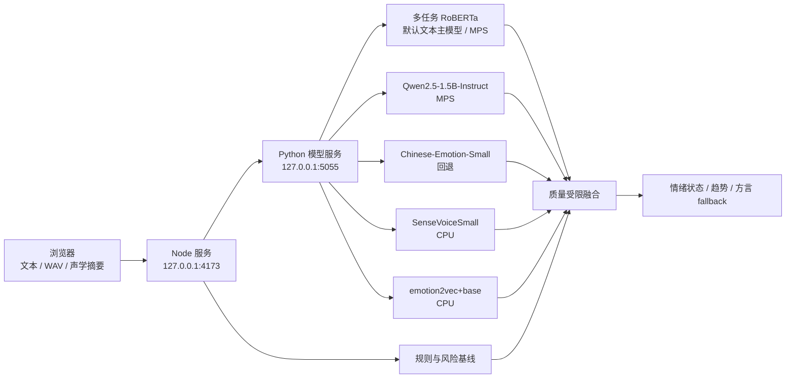

# 本地模型集成说明

## 1. 整体架构



Node 服务在模型超时或离线时直接使用规则与浏览器声学摘要，不阻塞请求。

## 2. 文本模型

### 主语义分支

- 仓库：[Qwen/Qwen2.5-1.5B-Instruct](https://huggingface.co/Qwen/Qwen2.5-1.5B-Instruct)
- 许可证：Apache-2.0
- 权重：约 3.09 GB
- 运行设备：Apple M5 MPS，float16
- 缓存后加载：约 5 秒
- 单句推理：约 1.3～1.8 秒
- 输出结构化六类、置信度、效价和唤醒度
- 对普通事务句偶发判成 `calm`

### 专用分类器

- 仓库：[Johnson8187/Chinese-Emotion-Small](https://huggingface.co/Johnson8187/Chinese-Emotion-Small)
- 许可证：MIT
- 权重：约 1.12 GB
- 原始八类：neutral、concerned、happy、angry、sad、questioning、surprised、disgusted
- 默认不预热，可通过 `TEXT_PROVIDER=classifier` 切换为文本主分类器

### 本地多任务微调模型

- 基座：`hfl/chinese-roberta-wwm-ext`
- 训练：BRIGHTER 官方 train 2445 条
- 焦虑补充：另一套中文对话 train 2297 条，权重 0.5
- 验证：官方 dev 190 条
- 密封测试：未看过官方 test 1449 条
- 输出：五类主情绪、多标签、负面概率和情绪强度
- 密封测试：Accuracy 80.2%，Macro-F1 75.2%，负面检测 F1 90.3%
- 同源独立 test：Accuracy 91.8%，Macro-F1 91.5%，焦虑 F1 88.9%
- 应用默认优先调用该模型，失败后回退 Qwen 和规则

在 36 条回归集上，规则为 100%，Qwen 为 86.1%，规则 + Qwen 为 97.2%。在 10 条全新留出集上，规则为 40%，Qwen 与融合均为 90%。规则线索存在时，模型最多占 8%；规则没有命中时才由 Qwen 补足分布。

BRIGHTER 的 1000 条外部测试样本给出更保守的结果：Qwen Accuracy 45.3%、Macro-F1 44.3%，专用文本分类器 Accuracy 44.4%、Macro-F1 38.0%。Qwen 校准后 ECE 为 8.3%，主要错误是把愤怒/烦躁判成焦虑。该结果说明模型有信息量，但尚不足以作为最终陪伴情绪识别能力。

## 3. 语音模型

- 仓库：[FunAudioLLM/SenseVoiceSmall](https://huggingface.co/FunAudioLLM/SenseVoiceSmall)
- 权重：约 936 MB
- 许可证：模型卡标为 `model-license`；比赛或商业使用前需要单独核对
- 框架：FunASR 1.4.19
- 运行设备：CPU
- 首次加载：约 117 秒（含首次下载）；缓存后约 2 秒
- 5.6 秒示例音频推理：约 0.58～0.63 秒
- 输出：普通话转写、语言标签、粗粒度情绪标签、语音/音频事件标签

### 专用语音情绪分支

- 仓库：[emotion2vec/emotion2vec_plus_base](https://huggingface.co/emotion2vec/emotion2vec_plus_base)
- 许可证：模型卡标为 `model-license`
- 权重：约 1.12 GB
- 运行设备：CPU
- 缓存后加载：约 1～2 秒
- 5.6 秒示例音频推理：约 0.19 秒
- 输出九类概率：angry、disgusted、fearful、happy、neutral、other、sad、surprised、unknown
- emotion2vec 概率优先于 SenseVoice 单一粗标签；SenseVoice 继续负责转写和事件

浏览器通过 Web Audio API 将麦克风输入降采样为 16 kHz、单声道、16-bit WAV。Node 服务只把 WAV 转发到本机 Python 服务，Python 推理完成后删除临时文件。

模型服务优先从 `.model-cache/huggingface` 的本地快照加载。已下载模型不依赖启动时网络；本地快照缺失时才需要在线下载。

## 4. 融合策略

文本结果由三部分组成：

1. 透明规则与风险检测；
2. Qwen 的语义标签与置信度；
3. 原始模型标签与证据。

规则存在明确文本线索时，模型最高只占 8% 权重。规则没有命中时，模型用于补充尚未覆盖的同义表达。

语音结果包括：

1. 浏览器声学摘要，用于质量和唤醒度；
2. emotion2vec 的九类情绪概率；
3. SenseVoice 的粗粒度情绪标签；
4. SenseVoice 转写文本，在用户未提供文本时参与规则分析。

所有模态都带有可用性、质量、模型版本和延迟字段。

## 5. 方言接口

当前只实现普通话模型，但接口接受安全格式的方言代码。非普通话请求不会报错：

```json
{
  "dialect": {
    "code": "mandarin",
    "used": "mandarin",
    "requested": "sichuan",
    "supported": false,
    "mode": "fallback",
    "calibrated": false,
    "warning": "当前仅提供普通话模型，方言请求已回退，结果未作方言校准。"
  }
}
```

未来增加方言时，只需增加 ASR、情绪模型和校准配置，不改变前端和会话状态结构。

## 6. 启动与检查

一条命令启动模型服务和网页：

```bash
npm run demo
```

能力检查：

```bash
curl http://127.0.0.1:4173/api/v1/emotion/capabilities
```

模型不可用时，该接口会报告 `ready: false`，情绪分析仍通过自动测试中的规则回退路径完成。

## 7. 资源与限制

- 主模型权重合计约 5.2 GB；
- PyTorch、FunASR、虚拟环境与缓存合计预计 7～10 GB；
- 16 GB 内存足够单个用户演示；
- 不同时开启大批量推理；
- MacBook Air 无风扇，长时间批处理会降频；
- 当前默认文本模型已在本机完成多任务微调，但未做正式说话人隔离评测；
- Qwen 自报置信度不能直接当作经过校准的概率；
- 风险规则不能替代人工安全流程。
