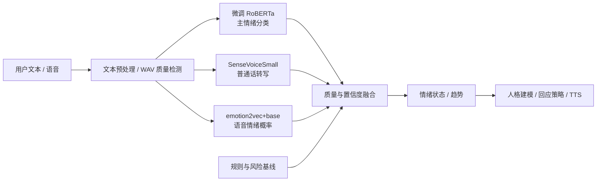

# 普通话情感识别模块两周阶段报告

**项目：** 情感陪伴机器人
**汇报模块：** 情感识别
**文档版本：** v1.0
**日期：** 2026-11-04
**用途：** 组会汇报、导师评审、阶段归档

---

## 摘要

本阶段负责情感识别模块，不负责人格建模、方言语音生成和机器人回复策略。工作目标是把用户的文本、语音和会话上下文转换为结构化情绪状态，向其他模块提供稳定接口。

阶段内完成了规则基线、多模态融合、公开数据评测、多任务微调、置信度决策和端到端联调。最终普通话模型在同一批 1000 条 BRIGHTER 测试样本上达到 76.5% Accuracy、66.0% Macro-F1；在未参与调参的 1449 条官方 test 补充集上达到 80.2% Accuracy、75.2% Macro-F1。负面情绪二分类 F1 为 90.3%。

当前模型已经可以作为陪伴机器人的情感识别原型，但尚不能替代人工判断。主要限制是评测数据缺少说话人分组、真实陪伴场景数据不足、焦虑和中性边界仍不稳定。

---

## 1. 模块定位与边界

### 1.1 本人负责内容

- 普通话文本情绪识别；
- 语音转写与语音情绪识别接入；
- 文本、语音和声学特征的融合；
- 效价、唤醒度、强度和置信度输出；
- 多轮情绪趋势；
- 危机风险信号；
- 模型评测、训练、服务接口和测试。

### 1.2 不属于本人负责内容

- 人格建模；
- 陪伴回复生成；
- 方言语音合成；
- 用户长期画像；
- 心理或医学诊断；
- 实际危机救援流程。

### 1.3 模块接口目标

```text
用户文本 / 语音
        ↓
情绪类别 + 情绪分布 + 强度 + 置信度 + 趋势 + 风险
        ↓
人格建模 / 回应策略 / TTS
```

---

## 2. 系统方案



### 2.1 文本分支

- 主模型：`hfl/chinese-roberta-wwm-ext`
- 训练方式：多任务监督微调
- 主任务：五类分类
- 辅助任务：多标签情绪、负面二分类、情绪强度回归
- 输出类别：高兴、悲伤、焦虑、愤怒/烦躁、中性
- 平静类由规则分支补充；训练公开数据没有明确的 calm 标签。

### 2.2 语音分支

- `FunAudioLLM/SenseVoiceSmall`：普通话转写、语言标签、粗粒度情绪和音频事件；
- `emotion2vec/emotion2vec_plus_base`：九类语音情绪概率；
- 浏览器生成 16 kHz 单声道 WAV；
- 原始音频只在本地回环地址处理，不上传外部服务。

### 2.3 可靠性策略

- 微调模型结果作为主导；
- 明确“平静”线索由规则保留；
- 模型判中性、规则存在高置信度情绪线索时，保留规则结果；
- 模型服务失败时回退到规则与 Qwen；
- 低置信度不强行输出细分类，进入澄清模式。

---

## 3. 两周工作拆解

### 第一周：基线与接口

1. 明确模块职责和 JSON 接口；
2. 实现六类情绪和安全风险规则；
3. 完成会话状态和最近五轮趋势；
4. 建立可运行页面与自动测试；
5. 接入浏览器声学摘要；
6. 打通普通话规则基线。

### 第二周：模型化与实证

1. 对比 Qwen、中文情绪分类器和规则；
2. 引入 SenseVoiceSmall 与 emotion2vec；
3. 构建外部公开数据评测；
4. 加入去重、标签映射、固定划分和数据指纹；
5. 微调多任务中文 RoBERTa；
6. 补充焦虑训练数据；
7. 进行同集对照、密封测试和置信区间分析；
8. 验证多标签融合与层级模型；
9. 将最终模型接入服务并完成回归测试。

---

## 4. 数据与评测协议

### 4.1 外部数据一：Chinese Multi-Emotion Dialogue

- 许可证：MIT；
- 原始样本：4159；
- 可映射到当前类别：3271；
- 测试：650；
- 限制：
  - 没有说话人字段；
  - 标签存在可见噪声；
  - Chinese-Emotion-Small 使用该数据训练，不能作为其独立测试。

### 4.2 外部数据二：BRIGHTER Chinese

- 许可证：CC-BY-4.0；
- BRIGHTER 中文官方 train/test；
- 映射后训练：2445；
- dev：190；
- test：2449；
- 前 1000 条 test 用于开发和错误分析；
- 剩余 1449 条作为密封测试；
- 排除标签并列样本和只有 surprise 的样本；
- 全零强度映射为 neutral。

### 4.3 防止数据泄漏

- BRIGHTER 官方 train/dev/test 不混用；
- test 不参与训练、早停或提示词调整；
- 1449 条密封 test 在最终评估前未使用；
- 同源数据训练与测试单独标注；
- 不把公开数据训练集重新当作独立测试集。

---

## 5. 关键实验结果

### 5.1 同一批 1000 条 BRIGHTER 测试

| 方法 | Accuracy | Macro-F1 |
| --- | ---: | ---: |
| 多数类基线 | 40.8% | 11.6% |
| 规则 | 29.6% | 24.3% |
| Qwen 少样本提示 | 45.3% | 44.3% |
| Chinese-Emotion-Small | 44.4% | 38.0% |
| 组合训练 RoBERTa | **76.5%** | **66.0%** |

结论：

- 监督微调精度比 Qwen 少样本提示高 31.2 个百分点；
- Macro-F1 高 21.7 个百分点；
- 规则适合提供明确线索和风险兜底，不适合单独主导细分类。

### 5.2 1449 条密封 BRIGHTER 测试

| 指标 | 结果 |
| --- | ---: |
| Accuracy | **80.2%** |
| Macro-F1 | **75.2%** |
| 负面检测 F1 | 90.3% |
| 负面检测 Recall | 93.4% |
| 负面检测 Precision | 87.4% |

### 5.3 另一套数据的同源留出 test

| 指标 | 结果 |
| --- | ---: |
| 样本量 | 650 |
| Accuracy | 91.8% |
| Macro-F1 | 91.5% |
| 焦虑 F1 | 88.9% |
| 焦虑 Recall | 92.6% |
| 焦虑 Precision | 94.0% |

需要强调：这是与训练相同来源的留出测试，不是跨数据集泛化结果。它说明增加焦虑训练样本能解决焦虑召回不足，但不能证明在真实陪伴场景同样有效。

---

## 6. 置信度与主动澄清

最终模型在密封集上的覆盖率与准确率：

| 置信度门槛 | 覆盖比例 | 覆盖样本 Accuracy |
| ---: | ---: | ---: |
| 0.5 | 94.9% | 82.5% |
| 0.7 | 81.1% | 86.1% |
| 0.8 | 70.7% | 89.1% |
| 0.9 | 46.4% | 94.7% |

模块输出三档决策：

- `confident`：高置信度，可输出细粒度情绪；
- `tentative`：建议确认，不用于强判断；
- `clarify`：信息不足，应使用开放式追问。

示例：

```text
置信度 ≥ 0.7：
“听起来你现在比较焦虑。”

0.4 ≤ 置信度 < 0.7：
“你听起来有些不安，我理解得对吗？”

置信度 < 0.4：
“听起来你不太好受，愿意多说说发生了什么吗？”
```

---

## 7. 错误分析

当前主要错误：

- 中性表达被判为愤怒/烦躁；
- 轻度愤怒被判为中性；
- 悲伤和中性边界不稳定；
- 焦虑样本少，焦虑召回仍然脆弱；
- 反讽、省略表达和上下文依赖表达错误明显。

本轮测试的 1000 条结果中，主要混淆包括：

- neutral → anger_irritation：53 条；
- anger_irritation → neutral：34 条；
- sadness → neutral：24 条；
- neutral → joy：23 条。

这些错误说明模型已经学到明显情绪，但还不能很好处理情绪强度和语境。

---

## 8. 验证后没有采用的方案

### 8.1 固定多标签融合

主分类头与多标签头固定 70/30 融合后：

- Accuracy：76.1%；
- Macro-F1：63.8%；
- 低于主分类头 Macro-F1 66.0%。

结论：未上线。

### 8.2 dev 自动权重搜索

只在 dev 搜索权重，选择 0.5：

- dev Macro-F1：72.7%；
- test Macro-F1：63.0%。

结论：dev 选择没有在 test 成立，未上线。

### 8.3 层级门控模型

尝试“中性门控 + 情绪细分类”的冻结特征堆叠器：

- 密封 Accuracy：79.8%，低于扁平模型 80.2%；
- 密封 Macro-F1：75.2%，与扁平模型相同；
- 焦虑 test Accuracy：91.2%，低于扁平模型 91.8%。

结论：未上线，保留为可复现实验。

---

## 9. 工程交付

- 29 项自动化测试全部通过；
- 本地文本、语音、语音情绪三模型服务；
- 模型失败时规则和 Qwen 回退；
- 方言代码接口保留，但只返回普通话 fallback；
- 320px、721px、1280px 页面检查通过；
- 原始录音不离开本机；
- 模型和会话都有资源上限；
- 可一键启动：`npm run demo`。

演示地址：`http://127.0.0.1:4173`

---

## 10. 当前限制

1. 外部数据没有说话人字段，不能称为说话人隔离评测；
2. 高质量真实陪伴对话不足；
3. 焦虑样本在 BRIGHTER 密封集中为空；
4. calm 类缺少公开监督数据；
5. 当前主要做单句判断，多轮上下文尚未参与模型训练；
6. 置信度仍未在真实用户数据上正式校准；
7. 语音情绪尚未使用有许可的真实普通话情绪语音数据评测。

---

## 11. 下一步计划

### 短期

- 收集 300～500 条真实陪伴场景普通话数据；
- 按说话人隔离训练、dev、test；
- 增加多轮上下文；
- 专门补充 calm、anxiety 和 neutral 边界样本；
- 在真实数据上重新做置信度校准。

### 中期

- 训练多轮上下文编码器；
- 增加愤怒/焦虑/悲伤二级分类器；
- 对文本、语音和记忆上下文做完整消融；
- 引入用户反馈闭环，但只用于聚合改进，不直接更新线上模型。

### 长期

- 再进行真正的方言适配；
- 评估不同设备、噪声和说话人风格；
- 开展用户感知实验；
- 完成安全审核与人工兜底流程。

---

## 12. 组会三分钟口述稿

> 我负责的是情感识别模块，不负责人格建模和方言语音生成。我的输入是用户当前文本、语音以及最近几轮状态，输出是情绪分布、强度、置信度、趋势和风险信号。
>
> 前期我先实现了规则基线和统一接口，然后加入 Qwen、Chinese-Emotion-Small、SenseVoice 和 emotion2vec，完成多模态联调。
>
> 为了避免只在自己写的小样本上测试，我使用了两套公开中文情绪数据。在 Qwen 用过的同一批 1000 条 BRIGHTER 测试上，Qwen 少样本提示是 45.3% Accuracy、44.3% Macro-F1；使用官方 train 和额外焦虑样本联合微调 RoBERTa 后，提高到 76.5% Accuracy、66.0% Macro-F1。
>
> 我另外保留了 1449 条没有参与调参的官方 test。最终模型在上面达到 80.2% Accuracy、75.2% Macro-F1，负面情绪检测 F1 是 90.3%。焦虑类在另一套同源 test 上达到 88.9% F1、92.6% Recall。
>
> 我没有把结果包装成跨数据集结论。剩余问题主要是缺少说话人分组和真实陪伴对话，且焦虑、中性和轻度愤怒的边界仍不稳定。下一步会采集真实多轮陪伴数据，再训练上下文模型，并在真实数据上重新校准置信度。

---

## 13. 导师可能提问

### 为什么 Qwen 45%，最后模型 80%？

这两个数字不是同一测试口径。回答时应说明：

- Qwen 与最终模型在相同 1000 条测试上分别是 45.3% 和 76.5%；
- 80.2% 来自另外 1449 条密封 test；
- 监督微调直接学习任务标签和类别边界，因此比少样本提示显著提升。

### 有没有数据泄漏？

- BRIGHTER 使用官方 train/dev/test；
- 调参只使用 dev；
- 最终 1449 条在评估前未使用；
- 另一套数据的 test 与 train 同源，必须明确标记为同源留出，不冒充跨数据集。

### 为什么还不能直接上线？

- 缺少说话人隔离评测；
- 真实陪伴场景与公开评论数据存在差异；
- 中性/愤怒边界仍会出错；
- 置信度只在公开 dev 上分析，尚未在真实用户分布校准。

### 为什么保留规则？

规则不是主分类器，用于：

- 提供可解释证据；
- 保护明确“平静”线索；
- 在模型高置信度误判中性时避免抹掉明显焦虑；
- 独立进行风险提醒；
- 模型服务失败时保证系统可用。

---

## 14. 相关材料

- [情感识别模块需求与接口规约](emotion-recognition-spec.md)
- [微调模型结果](finetuned-model-results.md)
- [BRIGHTER 外部评测结果](brighter-chinese-results.md)
- [外部数据来源与许可证](external-data-sources.md)
- [输出策略调参记录](brighter-output-tuning.md)
- [阶段报告](mvp-report.md)
- [工作清单](worklist.md)
